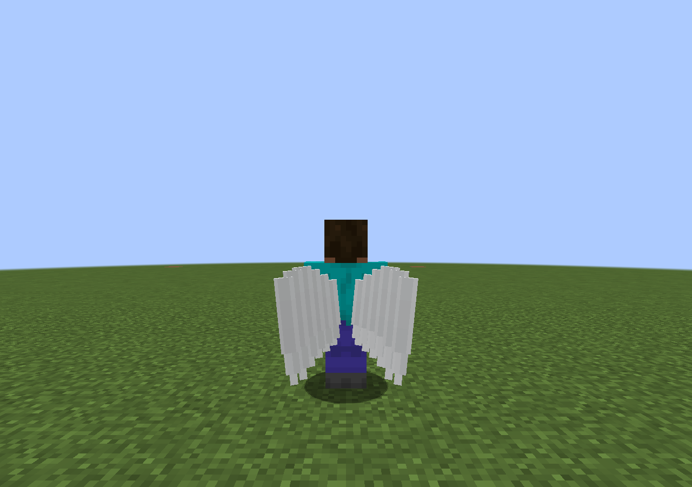

# Zorykai Cosmetics — teste de asas 3D

Minecraft 1.21.1, Fabric e Java 21. Modelo original de asa de anjo, com um único par de penas principais, pontas compridas e batida lenta ao andar. Seis paletas usam o mesmo modelo nesta primeira versão. Não concede voo.

[Correções da versão 0.1.1](docs/CHANGELOG-0.1.1.md)



## Instalar e testar

1. No servidor: substitua o Essentials anterior pelo `shirokai-essentials-0.6.2-guard.1-zorykai-visual.jar`. Preserve configs e dados; reinicie.
2. No Minecraft do jogador: coloque `zorykai-cosmetics-client-0.1.1-test.1.jar` na pasta `mods`, com Fabric API para 1.21.1. Não instale o Essentials no cliente.
3. Libere `shirokai.essentials.cosmetics.use` e `shirokai.essentials.cosmetics.wings_stars` no LuckPerms. Use os demais IDs para outras cores, como `wings_fire`.
4. Abra `/cosmeticos` → **Asas** → **Estelar**, e use F5 para ver pelas costas. O menu ainda conserva a descrição de partículas para clientes sem o complemento.

Quem não tem o complemento pode continuar entrando: vê a alternativa de partículas. Quem tem recebe a geometria 3D e não recebe as partículas das asas. As permissões e escolhas são controladas pelo servidor; o protocolo não aceita pedidos de concessão feitos pelo cliente. A sincronização acontece a cada cinco ticks e respeita quais jogadores o cliente está acompanhando.

As asas acompanham o tronco, incluindo agachamento. Ficam ocultas na primeira pessoa do próprio jogador, ao montar, nadar, planar, ficar invisível ou morrer. Desativar cosméticos remove o modelo e mantém a escolha salva. A opção também oculta modelos de outras pessoas para o jogador que a desativou.

## Modelo editável

Abra [`models/angel.bbmodel`](models/angel.bbmodel) no Blockbench. Geometria e textura são originais, inspiradas nas referências visuais fornecidas pelo usuário; nenhum recurso de outro mod foi extraído.

O arquivo editável e `AngelGeometry.java` são exportados pelo mesmo gerador `tools/generate_angel.py`. Esta versão não importa `.bbmodel` durante o jogo: mudanças feitas manualmente no Blockbench precisam ser exportadas/integradas ao renderizador e recompiladas. O renderer aplica o movimento das asas sobre a pose do corpo a cada quadro.

## Compilar

A partir da raiz do repositório, com Java 21:

```sh
./gradlew test remapJar
python3 scripts/package_enderchest_hotfix.py
./gradlew -p cosmetics-client remapJar
```

O source set `visualFixture` é exclusivamente de testes; seu JAR não é distribuído. O cliente inclui somente classes de renderização/protocolo, além dos recursos próprios, e não depende de LuckPerms ou Cobblemon.

## Evidências e limites

Foram usados um cliente gráfico real e um servidor local isolado em Minecraft 1.21.1/Fabric, com conexão de protocolo, comandos e cliques reais de menu automatizados. Capturas em `docs/` mostram o modelo branco, agachado, colorido e desativado. O resultado automatizado é salvo em `docs/visual-results.json`.

Também foram executadas as regressões do servidor com jogadores simulados, com e sem Cobblemon 1.8.3/Raids/Guard. Isso não valida compatibilidade visual com shaders, mods que substituam o renderer do jogador, armaduras ou todos os modelos de montaria. A revisão gráfica inicial usou o corpo padrão do Minecraft, sem Cobblemon no cliente; o teste do servidor com Cobblemon está documentado separadamente. Não foi realizado teste visual de dois clientes simultâneos.

Esta entrega contém a asa de anjo em seis cores. Modelos próprios de fênix, morcego e borboleta ainda não foram implementados.
